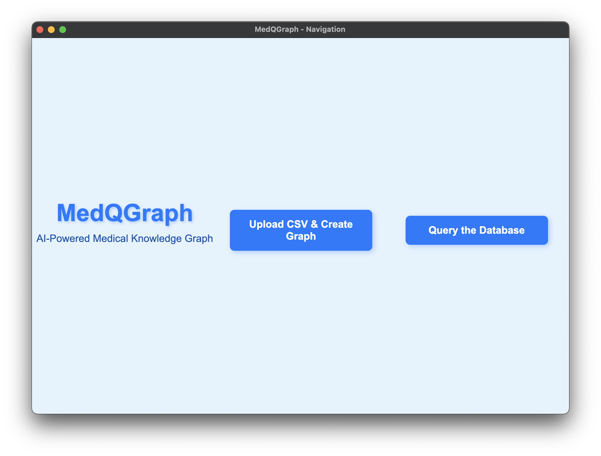

# MedQGraph

Turning MIMIC-IV intensive-care records into a temporal medical knowledge graph,
so that a clinical question asked in plain English becomes a Cypher traversal
instead of a six-table SQL join.



> **Status: research prototype.** Built as graduate research at Northeastern
> University. Not validated for clinical use, and nothing here should inform
> care decisions.

---

## What it does

Six MIMIC-IV v3.0 modules — demographics, admissions, medications, labs,
microbiology and diagnoses — are joined, denormalised and loaded into Neo4j as
`Patient`, `Admission`, `Diagnosis`, `Medication`, `Procedure` and `Test` nodes,
connected by time-stamped edges (`HAD_ADMISSION`, `DIAGNOSED_WITH`,
`PRESCRIBED`, `UNDERWENT_TEST`, `HAS_MEDICAL_HISTORY`, `HAS_RISK`).

The loaded graph holds **230,000 clinical event records across 31 features**,
covering **45,127 patients and 78,043 admissions** from 2008 to 2019.

A question then takes this path, through four GPT-4o agents:

```
"Medications for patient 10000032"
        |
        v
  Query Understanding   ->  clinical intent + entities
        |
        v
  Cypher Generation     ->  schema-validated Cypher
        |                   (syntax, schema, properties, query cost;
        |                    failures regenerate with feedback)
        v
  Neo4j AuraDB          ->  rows
        |
        v
  Summarization         ->  clinician-readable answer
        |
        v
  Recommendation        ->  3-5 follow-up questions built from the
                            relationships the answer touched
```

That example produces:

```cypher
MATCH (p:Patient {subject_id: 10000032})
      -[:HAD_ADMISSION]->(a:Admission)
      -[:PRESCRIBED]->(m:Medication)
RETURN m.drug_name
```

LangChain embeddings place queries and graph entities in a shared vector space,
giving similarity-based retrieval alongside the generated Cypher. An Electron.js
and NetworkX interface presents the result as an explorable timeline.

Full detail: **[docs/schema.md](docs/schema.md)** for the data model, the ingest
pipeline and the agent chain; **[docs/benchmarks.md](docs/benchmarks.md)** for
measurements and their limits.


## Why a graph

The questions clinicians actually ask — what has this patient been treated with
before, what did the last admission find, what preceded this diagnosis — are
traversals. In the relational schema each one is a multi-table join written by
hand. In a graph they are a path, which is also what makes them expressible to a
language model: the schema is small enough to put in a prompt, so the model can
write the query.

## Results in brief

On the project's own Medication / Diagnosis / Risk Assessment benchmark (n = 50,
MIMIC-IV-derived):

| | |
|---|---|
| Average query latency | **490 ms → 172 ms**, a 2.85x speedup over the SQL baseline |
| Natural language to valid Cypher | **94.3%** |
| Summaries rated accurate by clinical-expert review | **89.7%** |
| Query-to-insight, against manual EHR navigation | ~8.5 min → **~15 s** |

These come from an internal benchmark rather than a community-adopted one, and
MIMIC-IV is a single institution's critical-care database. Both limits, and the
rest, are set out in [docs/benchmarks.md](docs/benchmarks.md).

## Pipeline

Two diagrams document the ingest, viewable at [diagrams.net](https://app.diagrams.net):

- [`docs/data-creation-pipeline.drawio`](docs/data-creation-pipeline.drawio) —
  source modules through to the integrated dataset
- [`docs/complete-pipeline.drawio`](docs/complete-pipeline.drawio) — the same,
  plus the quality gates and the Neo4j export

<!-- TODO: export both to PNG and embed them here. GitHub will not render
     .drawio inline, so a reader currently has to download them.
     In diagrams.net: File > Export as > PNG. -->

## Data

MIMIC-IV v3.0, from PhysioNet. **No patient data is in this repository and none
may be added to it.** MIMIC-IV is credentialed-access data under a data use
agreement that forbids redistribution. To run any of this you need your own
PhysioNet credentials and your own local copy.

Before ingestion, MIMIC-IV v3.0 and MIMIC-IV-ED are mapped to FHIR profiles
following the MIMIC-IV-on-FHIR transformation — see
[docs/schema.md](docs/schema.md).

The `.gitignore` blocks `data/`, `*.csv`, `*.parquet` and Neo4j dumps.
Notebook outputs are the other way patient rows escape, so clear them before
committing.

## Running it

<!-- TODO: fill in once src/ has code in it. -->

```bash
cp .env.example .env     # add your Neo4j and OpenAI credentials
```

Requires a Neo4j AuraDB instance and an OpenAI or Azure OpenAI deployment.
See [`src/README.md`](src/README.md).

## Credits

Built by **Ishan Chaudhary** and **Isaac Premkumar** as graduate research at
Northeastern University.

My part was the data pipeline, the LLM backend and the evaluation: the
three-stage join that turns six MIMIC-IV modules into the 230,000-record
integrated dataset, with its quality gates and FHIR normalisation; the GPT-4o
integration that converts a natural-language question into schema-validated
Cypher and a clinician-readable summary; and the testing behind the figures in
[docs/benchmarks.md](docs/benchmarks.md), including the four-model
Cypher-generation comparison.

The poster in `docs/` carries its own author list — Isaac Premkumar, Ishan
Chaudhary, Arasu Narayan and Divya Chaudhary — and that remains the
citation for the poster itself.

<!-- NOTE: this repository holds design artifacts and documentation, no code.
     If you later move implementation into src/ that came from the team
     repository, Nandini Bommireddy and Lavanya Vijayakrishnan wrote most of it
     and need crediting here. See src/README.md. -->

<!-- NOTE: a full paper describing this system is under anonymous review. It is
     deliberately not included in this repository and not cited above. Check the
     venue's anonymity policy with your advisor before this repo goes public —
     a public repository carrying the paper's figures and numbers can count as
     advertising a submission during the anonymity period. -->

Recognised with Microsoft External Honors through Northeastern University's
College of Engineering.

## Licence

<!-- TODO: the team repo carries a LICENSE file; carry the same one over, and
     check with the authors before republishing their code under it. -->
