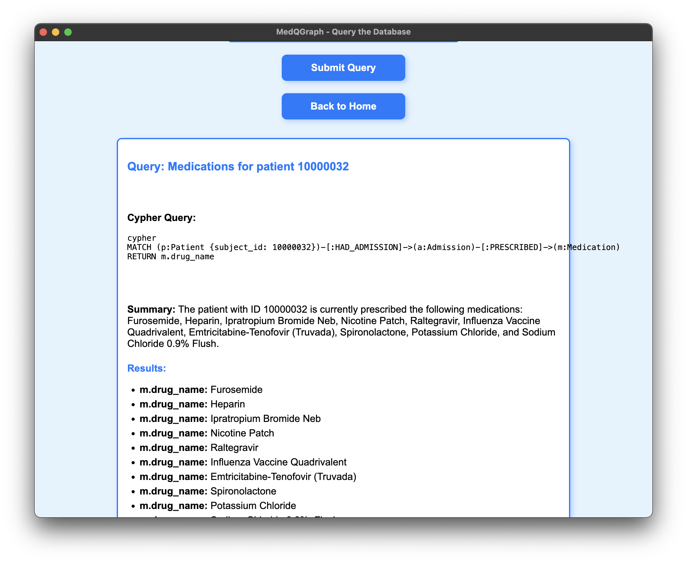

# MedQGraph

Turning MIMIC-IV intensive-care records into a queryable medical knowledge graph,
so that a clinical question asked in plain English becomes a Cypher traversal
instead of a six-table SQL join.


> **Status: research prototype.** Built as graduate research at Northeastern
> University. Not validated for clinical use, and nothing here should inform
> care decisions.

---

## What it does

Six MIMIC-IV tables — patients, admissions, prescriptions, lab events,
microbiology events and ICD diagnoses — are joined, denormalised and loaded into
Neo4j as `Patient`, `Admission`, `Diagnosis`, `Medication` and `Test` nodes
connected by clinical relationships such as `HAD_ADMISSION` and `DIAGNOSED_WITH`.
The loaded graph covers **45,127 patients and 78,043 admissions**, from a
**230,000 x 31** integrated dataset.

A question then takes this path:

```
"Medications for patient 10000032"
        |
        v
  GPT-4o + schema description  ->  Cypher
        |
        v
  Neo4j AuraDB traversal       ->  rows
        |
        v
  GPT-4o                       ->  plain-language answer
        |                           + 3-5 follow-up questions built from
        v                             the relationships the answer touched
  Electron client (NetworkX visualisation)
```

LangChain embeddings back a vector search for similarity-based retrieval
alongside the generated Cypher.

Full detail: **[docs/schema.md](docs/schema.md)** for the data model and the
ingest pipeline, **[docs/benchmarks.md](docs/benchmarks.md)** for measurements.



## Why a graph

The questions clinicians actually ask — what has this patient been treated with
before, what did the last admission find, what preceded this diagnosis — are
traversals. In the relational schema each one is a multi-table join written by
hand. In a graph they are a path, which is also what makes them expressible to a
language model: the schema is small enough to put in a prompt, so the model can
write the query.

## Pipeline

The ingest is documented in two diagrams, viewable at
[diagrams.net](https://app.diagrams.net):

- [`docs/data-creation-pipeline.drawio`](docs/data-creation-pipeline.drawio) —
  source tables through to the integrated dataset
- [`docs/complete-pipeline.drawio`](docs/complete-pipeline.drawio) — the same,
  plus quality assurance and the Neo4j export

<!-- TODO: export both to PNG or SVG and embed them here. GitHub will not render
     .drawio inline, so right now a reader has to download them. In diagrams.net:
     File > Export as > PNG, then add them to docs/ and inline them. -->

## Data

MIMIC-IV v3.0, from PhysioNet. **No patient data is in this repository and none
may be added to it.** MIMIC-IV is credentialed-access data under a data use
agreement that forbids redistribution. To run any of this you need your own
PhysioNet credentials and your own local copy.

The `.gitignore` blocks `data/`, `*.csv`, `*.parquet` and Neo4j dumps for that
reason. Notebook outputs are the other way patient rows escape, so clear them
before committing.

## Running it

<!-- TODO: fill in once src/ has code in it. -->

```bash
cp .env.example .env     # add your Neo4j and OpenAI credentials
```

Requires a Neo4j AuraDB instance and an OpenAI or Azure OpenAI deployment.
See [`src/README.md`](src/README.md).

## Results

A latency and accuracy comparison against a SQL baseline, and a comparison of
four open language models on answer quality, are transcribed in
[docs/benchmarks.md](docs/benchmarks.md) — **with the caveat, stated there, that
the harness which produced them is not yet in this repository.**

## Credits

MedQGraph has been worked on by two overlapping groups, and this repository
separates what each produced.

**Poster and system design** — *MedQGraph: Temporal Medical Knowledge Graphs for
AI-Driven Healthcare Insights*: Isaac Premkumar, Ishan Chaudhary, Arasu Narayan,
Divya Chaudhary.

**Prototype implementation** — the Electron client, the Neo4j loader and the
query layer were written principally by Nandini Bommireddy and Lavanya
Vijayakrishnan, with Isaac Ritharson P, in
[lavanyavijayk/MedQGraph](https://github.com/lavanyavijayk/MedQGraph).

<!-- TODO: state your own contribution in one honest sentence, and put it here.
     Your portfolio currently says you "architected" MedQGraph; this is the line
     that has to support it. The design artifacts in docs/ are yours. Any code
     you move into src/ should be code you wrote. -->

Recognised with Microsoft External Honors through Northeastern University's
College of Engineering.

## Licence

<!-- TODO: the team repo carries a LICENSE file; carry the same one over, and
     check with the authors before republishing their code under it. -->
